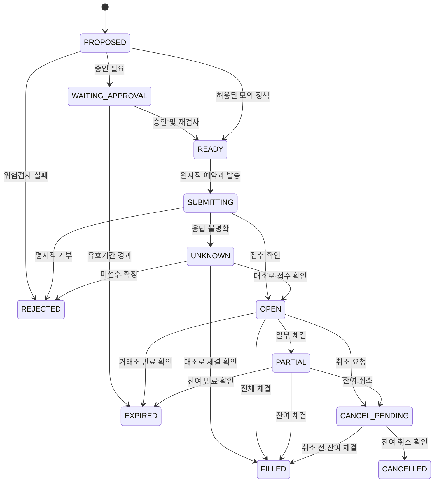

# Investment Town — 판단·매수·매도 알고리즘 명세

작성일: 2026-09-11 · 버전: 1.0 · 상태: 검증 전 설계

[전체 구조](CLAW3D_MULTI_LLM_DESIGN.ko.md) · [구현·검증 계획](CLAW3D_DELIVERY_PLAN.ko.md)

**이 문서의 수치는 연구용 시작값이며, 최적화된 투자 전략이나 검증된 수익률을 의미하지 않는다.** 모든 모델·기간·비용·문턱값은 `policy_version`으로 고정한다. 변경 후 성과를 기존 버전과 섞지 않는다.

## 1. 용어와 판단 단위

| 기호/필드 | 의미 |
|---|---|
| `instrument_id` | 시장·거래소·통화·종목을 구분하는 내부 ID. ticker만으로 식별하지 않는다. |
| `t` | 판단에 사용할 자료의 이용 가능 시각 마감 |
| `H` | 예측 기간. 기본 5거래일이며 달력의 5일과 다르다. |
| `R_j,H` | 미래 기준 진입시점부터 H까지 종목 j의 배당 포함 총수익률 |
| `R_b,H` | 같은 진입·종료시점의 사전 지정 벤치마크 총수익률 |
| `alpha_j,H` | `R_j,H - R_b,H`. 거래비용 차감 전 초과수익률 |
| `p_raw` | LLM이 제시한 원시 확률. 정확한 확률이라는 보장이 없다. |
| `p_final` | 별도 미래 검증 자료에서 평가한 최종 보정 확률 |
| `NAV` | 평가시점 현금+시가 평가 자산+수취채권−미지급금 |
| `w_j` | 종목의 시가 평가액/NAV. 10%는 0.10으로 저장한다. |
| `C_rt` | 예상 왕복 거래비용을 거래금액으로 나눈 수익률 단위 값 |

비율은 계산에서 소수로 통일한다. 예: 20bp = 0.002 = 0.20%. 금액은 Decimal 또는 충분한 정밀도의 정수 원장으로 계산한다. 원장 금액을 float로 누적하지 않는다.

결정은 다음 두 층으로 구분한다.

- **연구 결과:** 지지/반대 근거, 불확실성, 유효기간, 공통 질문에 대한 예측.
- **실행 결정:** `BUY`, `HOLD`, `REDUCE`, `EXIT`, `WAIT`. `SELL`은 보유량 축소를 실행하는 주문 방향이다. 보유량이 0일 때 음수 포지션을 만들지 않는다.

`ABSTAIN`은 평가자가 정보 부족으로 예측을 내지 않은 상태다. `WAIT`는 시스템이 이번 시점에 새 주문을 만들지 않기로 한 결과다. 포지션을 이미 보유한 경우에도 WAIT와 별개로 기존 위험 감시는 계속된다.

## 2. 데이터 수집과 시점 고정

### 단계 A — 거래 가능 후보 집합

거래일별 후보는 실제로 당시 상장되어 있던 종목에서 만든다. 현재 살아남은 종목 목록만 과거에 적용하면 생존편향이 발생한다.

기본 후보 조건:

1. 사전 허용 목록, 현금 매수 가능, 정수 수량 거래 가능.
2. 거래정지·상장폐지 절차·가격 검증 실패 종목 제외.
3. 완결된 252거래일 가격 이력 확보. 짧은 이력 종목은 별도 전략 버전으로 분리.
4. 최근 20일 중위 일거래대금이 실험 설정 이상. 미국 주식 시작값은 USD 2천만.
5. 신규 주문 직전 호가 스프레드 20bp 이하, 시세 연령 5초 이하를 시작값으로 적용.
6. 다음 1거래일 내 예정된 실적 발표가 확인되면 신규 진입을 보류한다. 일정 데이터가 없으면 `UNKNOWN_EVENT_CALENDAR`로 보류한다.

이 값은 미국 주식 정규장 프로필 전용이다. 국내 주식·ETF·시간외 거래에 그대로 복사하지 않는다. 지연 시세 계약을 사용하면 5초 조건을 충족하는 것처럼 시각을 덮어쓰지 않는다.

신규 매수 후보에서 제외되어도 기존 보유 종목의 평가·매도·위험 감시를 중단하지 않는다. 연구 대상은 신규 후보와 기존 보유 종목의 합집합이며, 진입 필터는 신규 매수에만 적용한다.

### 단계 B — 자료 묶음

`MarketSnapshot`에 다음을 연결한다.

- 원시 OHLCV와 point-in-time 기업행동 보정 계열.
- bid/ask/last, 거래소시각, 수신시각, 통화, tick size.
- 공시 접수번호·발표시각·원문 해시, 재무 태그·기간·단위.
- 뉴스 원문 출처, 최초 공개시각, 갱신시각, 중복 묶음 ID.
- 벤치마크·금리·환율의 발표/이용 가능 시각.
- 자료 누락, 시간 역전, 공급자 불일치 등의 quality flag.

기사 10개가 같은 공시를 재인용하면 독립 근거 10개로 계산하지 않는다. 출처가 다른 웹사이트라도 원문이 같으면 하나의 근거 묶음이다. 수치 검증 실패 또는 중요 사실 간 모순이 해소되지 않으면 신규 진입을 차단한다.

분석 시점에는 `available_at <= t`인 자료만 전달한다. 최초 수집시각을 모르는 과거 자료는 신뢰 가능한 공개시각과 보수적 수집 지연을 적용한 **가정 재현 데이터**라고 표시한다. 실제 당시 수집을 보장한다고 주장하지 않는다.

## 3. LLM 전에 계산하는 퀀트 기준전략

LLM의 추가 가치를 비교할 단순한 기준전략을 먼저 만든다. 복잡한 전략을 임의로 섞어 기준선을 약하게 만들지 않는다.

### 지표

완결된 일봉만 사용한다.

$$
M_{126,21}=P_{t-21}/P_{t-126}-1
$$

최근 한 달을 제외한 중기 모멘텀이다. 단순 일수 명칭보다 실제 인덱스를 구현과 테스트에 명시한다.

$$
\sigma_{20}=\operatorname{Std}(\log(P_u/P_{u-1}),u=t-19,\ldots,t)\sqrt{252}
$$

일간 변동성과 연환산 변동성을 별도 필드로 저장한다.

$$
TR_t=\max(H_t-L_t,|H_t-C_{t-1}|,|L_t-C_{t-1}|)
$$

`ATR14`는 첫 14개 TR의 산술평균으로 시작한 Wilder smoothing `(13*ATR_prev + TR_now)/14`를 사용한다. 분할과 같은 기업행동 전후에는 OHLC가 같은 가격 기준이어야 한다.

퀀트 기준정책은 `종목 종가 > SMA200`, `벤치마크 종가 > SMA200`, 후보 중 모멘텀 상위 순으로 선택하고, 동일한 위험·체결 엔진으로 최대 8종목을 운용한다. 기준정책에도 수수료·현금 20%·종목 한도를 적용한다. 특정 종목을 지금 매수하라는 규칙이 아니라 비교 실험 정의다.

거시 LLM의 “risk-on” 문장으로 시장 필터를 변경하지 않는다. 시장 필터를 바꾸려면 별도 정책 버전과 검증이 필요하다.

## 4. 역할별 연구와 제한된 토론

### 분석 보고서 필수 필드

| 필드 | 규칙 |
|---|---|
| `snapshot_id`, `as_of` | 실행이 지정한 값과 정확히 같아야 함 |
| `claims[]` | 각 주장에 evidence_id, 사실/추론 구분, 반증 조건 |
| `numeric_claims[]` | 실제 계산 필드 또는 원문 수치와 연결 |
| `thesis_for`, `thesis_against` | 매수 근거와 반론을 함께 작성 |
| `material_unknowns[]` | 확인 불가 사항을 숨기지 않음 |
| `valid_until` | 자료의 유효기간, 주문 유효기간과는 별개 |
| `role_id`, `model_route_version` | 서버가 기록하는 실행 식별 정보 |

모델에는 새 URL을 임의로 인용하게 하기보다, 제공된 evidence_id에서 선택하게 한다. 링크가 존재하는지와 주장을 실제로 뒷받침하는지는 다른 검사다. 중요한 수치·공시 주장은 원문과 비교하며 자동 확인할 수 없으면 보류하거나 검토 대상으로 남긴다.

### 토론 규칙

1. Bull은 기회와 전제, Bear는 실패 경로와 가격에 이미 반영된 요소를 제시한다.
2. 추가 반론은 각자 최대 1회다. 무한 합의 루프를 만들지 않는다.
3. 새 사실이 나오면 수집기·검증기가 확인한 후 공통 자료에 반영한다.
4. 강한 반론이 끝까지 남으면 CIO가 덮지 않고 `unresolved_material_conflict`로 전달한다.
5. 최종 Judge 세 명에게 동일한 순서/버전의 사실 묶음을 전달한다. 순서 효과는 별도 실험에서만 바꾼다.
6. Judge의 첫 평가 결과는 서로 공개하지 않는다. 평가 간 토론은 기본 정책에 없다.

## 5. 공통 예측 질문과 모델 출력 계약

뉴스 분석가의 뉴스 감성과 기업 분석가의 기업 점수는 서로 다른 값이므로 단순 평균하지 않는다. 최종 Judge들은 다음 **하나의 같은 사건**을 예측한다.

> 고정된 자료 마감 이후 처음으로 실행 가능한 기준 시점부터 5거래일 동안, 이 종목의 배당 포함 총수익률이 지정 벤치마크보다 높을 확률은 얼마인가?

라벨:

$$
Y_{j,t}=\mathbf{1}[R_{j,H}-R_{b,H}>0]
$$

동률은 0으로 정의한다. 거래비용은 7절에서 별도로 계산한다. 이 확률은 절대 수익, 거래 성공, 손실 없음의 확률이 아니다. 벤치마크가 크게 하락하면 초과수익이 양수여도 손실일 수 있다.

LLM 출력 예시:

```json
{
  "schema_version": 1,
  "snapshot_id": "snap_example_001",
  "instrument_id": "US:XNAS:EXAMPLE:USD",
  "horizon_sessions": 5,
  "benchmark_id": "BENCHMARK_US_TOTAL_RETURN",
  "event_definition": "gross_total_return_exceeds_benchmark",
  "status": "PREDICT",
  "p_raw": 0.68,
  "evidence_ids": ["filing_example_001", "feature_example_001"],
  "counterevidence_ids": ["filing_example_002"],
  "invalidation_conditions": ["공시된 성장 전제가 후속 공시에서 철회됨"],
  "material_unknowns": [],
  "rationale_summary": "검증된 성장 자료가 있으나 마진 둔화 위험을 함께 반영했다."
}
```

예시의 종목·자료·확률은 가상이다. JSON Schema는 `additionalProperties: false`, 확률 `[0,1]`, 허용 enum·문자열 길이·정해진 horizon을 검증하도록 구현한다. `ABSTAIN`이면 `p_raw=null`이고 이유가 필요하다. 숫자 대신 문자열/NaN/범위 밖 값이면 실패다. 교정 요청은 1회만 허용하고 이후 기권 처리한다.

`p_calibrated`, 최종 action, 수량, 계좌, API 권한, 위험검사 통과 여부는 LLM 출력 필드로 받지 않는다. 서버 소유 필드다.

## 6. 모델 보정과 독립성 평가

### 6.1 초기 데이터가 없을 때

처음부터 `p_raw=0.8`을 “성공 확률 80%”로 표시하지 않는다. 데이터 수집 단계에서는 `UNCALIBRATED`로 표시하고 LLM 정책은 Shadow에서 판단을 누적한다. 별도의 퀀트 기준 가상계좌로 OMS와 체결 엔진을 검증한다.

모델별 성숙 라벨 200개 이상, 서로 다른 거래일 60일 이상을 보정 연구의 시작 조건으로 제안한다. 이는 충분한 통계적 증명의 기준이 아니다. 20종목을 같은 날 판단한 자료는 강하게 상관될 수 있어 표본의 실질 크기와 신뢰구간을 별도로 본다.

모델·프롬프트·도구가 바뀌면 다른 route version으로 기록한다. 새 버전은 바로 기존 버전의 승률을 물려받지 않는다. 대체 모델 장애 전환도 같은 규칙을 적용한다.

### 6.2 보정과 평가 분리

성숙된 데이터만 써서 Platt scaling 또는 충분한 표본에서 isotonic calibration을 학습한다. 학습에 쓴 예측값으로 보정 성능을 평가하지 않는다. 시간 순 분리 안에서 보정기 학습, 가중치 선택, 최종 앙상블 보정, 최종 외부 평가를 분리하거나 nested walk-forward의 out-of-fold 예측을 사용한다.

$$
p_m=g_m(p_{raw,m})
$$

$$
BS_m=\frac{1}{N}\sum_i(p_{m,i}-Y_i)^2
$$

Brier score, log loss, reliability plot, 기권율, 자료 누락율을 함께 본다. 보정기는 기간·시장·horizon·모델 버전에 묶인다. 신뢰구간과 표본이 없는 확률을 정밀한 소수점으로 포장하지 않는다.

### 6.3 상관된 판단의 영향 줄이기

서로 다른 모델도 같은 뉴스와 학습 자료 때문에 함께 틀릴 수 있다. 오차 `e_m = p_m-Y`의 상관을 외부 예측 자료에서 측정한다.

$$
u_m=\frac{\exp(-5BS_m)}{1+\frac{1}{M-1}\sum_{k\ne m}\max(0,\rho(e_m,e_k))}
$$

`5`는 시작값이며 검증 이전에 정책으로 고정한다. 이 식의 가중치가 수익 최적이라는 주장은 하지 않는다. `u/sum(u)`를 합계 1, 비음수, 개별 모델 최대 0.5, 동일 계열 합계 최대 0.5 제약을 만족하는 simplex에 투영한다. 단순히 0.5로 잘라 다시 정규화하면 한도가 깨질 수 있다.

오차 분산이 0이거나 상관을 추정할 자료가 부족하면 임의의 상관 0을 넣지 않고 동일 가중치 정책으로 돌아간다. 동일 계열 한도 때문에 해가 없으면 구성 실패다. 기본 자동 판단 quorum은 **승인된 세 평가자 모두**다. 기권·실패를 0.5의 찬성표처럼 채우지 않는다.

초기 성능 가중치 이전 실험은 세 모델 동일 가중치다. 가중치는 최대 주 1회, 당시까지 성숙한 자료만으로 갱신한다. 하루의 이익으로 다음 날 특정 모델에 자본을 몰아주지 않는다.

### 6.4 최종 확률

$$
\bar p=\sum_m w_m p_m,\qquad
D=\sqrt{\sum_m w_m(p_m-\bar p)^2}
$$

`D`는 모델 간 의견 차이이며 표준오차나 신뢰구간이 아니다. 모두 같은 오류를 내면 D가 낮을 수 있다.

퀀트 기준 모델의 같은 라벨에 대한 확률을 `p0`라 하고:

`p0`는 모멘텀, 종가/SMA200−1, 일간 변동성, 벤치마크 5일 수익률을 입력으로 하는 L2 정규화 로지스틱 회귀부터 시작한다. 결측 처리·표준화·계수·정규화 강도는 학습 구간에서만 적합하고 별도 외부 예측으로 보정한다. 데이터가 부족하면 확률 기반 운용은 보류한다. 3절의 규칙형 퀀트 기준계좌는 이 확률 모델과 별개다.

$$
p_{pool}=(1-\eta)p_0+\eta\bar p,\quad \eta=0.5
$$

$$
p_{final}=g_{ensemble}(p_{pool})
$$

개별 예측이 보정되어도 평균이 자동으로 보정되는 것은 아니다. 최종 앙상블도 별도 평가한다. 숫자 예시는 `g_ensemble`이 해당 구간에서 항등에 가깝다는 가정으로 제시한다. 보정 성능이 기준 확률보다 나쁘면 LLM 운용 승격을 보류하고 기준정책을 비교 계좌에서 유지한다.

## 7. 확률과 기대수익을 구분하는 진입 판단

### 7.1 기대수익 크기

확률이 0.7이라는 이유로 상승폭 10%, 하락폭 5%를 임의로 대입하지 않는다. LLM 목표가를 주문 수량의 근거로 직접 쓰지 않는다.

과거 외부 예측 구간에서 `p_final`, 퀀트 지표, 시장 국면별 미래 **절대 총수익 R**와 **초과수익 alpha**를 별도로 추정한다. 단순한 구간 평균과 전체 평균으로의 shrinkage부터 시작하고, 복잡한 회귀는 비교 실험 후 채택한다.

$$
\hat\mu_{shrunk}=\frac{n}{n+\kappa}\bar R_{bucket}+\frac{\kappa}{n+\kappa}\bar R_{global}
$$

`kappa=100`은 시작값이다. 구간 표본 부족·이상치·분포 이동은 품질 flag로 남긴다. 동일 방식으로 초과수익도 추정한다. 날짜 단위 block bootstrap으로 의존성을 고려한 평균수익의 불확실성을 추정한다. 이 신뢰구간은 미래 한 거래의 손실 범위를 제한하지 않는다.

초기 확률 구간 경계는 `[0, 0.45, 0.55, 0.60, 0.70, 1]`로 고정한다. 왼쪽 포함·오른쪽 제외, 마지막 구간만 1을 포함한다. 시장 국면은 벤치마크의 SMA200 위/아래로 구분한다. 해당 구간 표본이 50개 미만이면 상위 묶음으로 합치되 그 규칙과 사용 표본을 기록한다. 신뢰구간 하한은 일자 block bootstrap의 사전 고정한 단측 95% 분위수를 사용한다. 전체 자료도 부족하면 기대수익 조건을 충족했다고 표시하지 않는다.

### 7.2 거래비용

신규 진입의 비용은 진입·청산 수수료, bid-ask 비용, 지연/시장 충격 가정, 환전이 필요하면 환전 비용을 포함한다. 이미 bid/ask 기반 체결가격에 반영한 스프레드를 수수료처럼 다시 차감하지 않는다.

$$
LCB_{net}=LCB(\mu_R)-C_{rt}
$$

$$
LCB_{alpha,net}=LCB(\mu_{alpha})-(C_{rt}-C_{benchmark})
$$

벤치마크가 비용을 포함하지 않은 지수면 `C_benchmark=0`이다. 거래되는 ETF 기준전략이면 동일한 비용 가정으로 별도 계산한다. 데이터·LLM 고정비는 프로젝트 손익에서 차감하고, 매매비용과 중복 차감하지 않는다.

### 7.3 BUY 조건

다음 조건을 **모두** 만족해야 새 매수 후보가 된다.

1. 데이터·근거·세 평가자·보정기가 유효하다.
2. `p_final >= 0.60`, `D <= 0.12`.
3. `LCB_net > 0`, `LCB_alpha_net > 0`.
4. 벤치마크와 종목의 SMA200 필터 통과.
5. 해결되지 않은 중요 모순, 임박한 실적 발표, 거래정지 없음.
6. 일일 손실·낙폭 차단이 없고 계좌·시세·정책 버전이 최신.
7. 배분·수량·체결 가능성 검사 통과.

부족한 항목은 사유 코드로 기록한다. 확률 하나를 만족했다고 나머지 조건을 생략하지 않는다. 신규 후보의 순위는 `LCB_alpha_net / max(sigma_daily*sqrt(H), epsilon)`로 정하고 동률은 instrument_id로 안정 정렬한다.

## 8. 기본 위험 정책

| 정책 | 연구 시작값 | 적용 방식 |
|---|---|---|
| 종목 최대 비중 | NAV 10% | 기존 보유+미체결 매수의 최악 체결 가정 포함 |
| 섹터 최대 비중 | NAV 25% | 분류를 모르면 신규 매수 보류 |
| 위험자산 총 비중 | NAV 80% | 현금/결제 제약과 함께 검사 |
| 최소 현금 | NAV 20% | 주문 예약금과 예상 수수료 차감 후 |
| 신규 주문당 금액 | NAV 2% | 분할 주문 합산으로 우회하지 못하게 의도 단위 적용 |
| 한 진입의 계획 손실 | NAV 0.25% | stop 거리+비용으로 수량 제한. 실제 손실 상한 보장 아님 |
| 정상 매매 일회전 | NAV 10% | 당일 매수·매도 절대 체결금액 합계와 예약 포함 |
| 일일 손실 차단 | 전일 마감 대비 −2% | 신규 매수 취소/차단, 위험 감시는 유지 |
| 누적 최대낙폭 차단 | −8% | 신규 위험 중지, 원인 확인 후 운영자 재개 |
| 목표 연환산 변동성 | 12% | 수익 예측과 별도로 포트폴리오 전체 검사 |
| 매수 재진입 대기 | 청산 후 1거래일 | 동일 thesis의 매도·매수 반복 억제 |
| 최소 거래금액 | NAV 0.5% | 정상 리밸런싱의 미세 거래 억제; 위험 청산 제외 |
| 정상 주문 유효시간 | 60초 | 미체결은 취소 상태를 확인한 뒤 재평가 |
| 사람 승인 유효시간 | 5분 | 실행 직전 시세·버전 재검사도 별도로 필요 |

위험을 줄이는 매도는 정상 회전율·최소 금액·매수 쿨다운 때문에 막지 않는다. 다만 보유량·미체결 매도 예약·시장 상태·주문 권한·유효가격·중복 방지는 그대로 검사한다. 거래소가 정지했거나 신뢰할 가격이 없으면 자동 체결을 가정하지 않고 경고한다.

하루 손실과 누적 낙폭은 외부 입출금을 보정한 NAV 단위가격으로 계산한다. 단순 잔고 감소를 투자 손실로 오인하지 않는다. 계좌 평가가 불완전하면 신규 매수를 차단한다.

## 9. 포트폴리오 배분과 주문 수량

### 9.1 처리 순서

1. 기존 포지션의 강제 위험 조건과 매도 조건을 먼저 평가한다.
2. 필요한 미체결 매수 취소와 위험 축소 의도를 만든다.
3. 신규 매수는 **실제 확인된 가용 현금**만 사용한다. 아직 체결되지 않은 매도 예상 대금을 사용하지 않는다.
4. 매수 조건을 통과한 후보를 7절 순위로 정렬한다.
5. 각 후보에 남은 한도 내 수량을 제안한다. 같은 종목·signal epoch의 재실행은 기존 경제적 의도를 재사용한다.
6. 모든 미체결 매수는 체결되고, 미체결 매도는 아직 체결되지 않은 시나리오로 위험을 다시 검사한다.
7. 포트폴리오 전체 제약을 통과한 수량만 예약한다.

V1은 예측 수익률을 직접 최적화하는 복잡한 optimizer 대신 안정 정렬+한도 배분을 사용한다. 후보 순서를 기록해 결과를 재현할 수 있게 한다. 평균분산/CVaR 최적화는 V2 비교 대상으로 둔다.

### 9.2 손실 거리

처음 진입할 때:

$$
d=\max(2ATR14,0.03P_{cap}),\quad S=P_{cap}-d
$$

`P_cap`은 승인할 최대 매수가격, S는 계획 손절 기준이다. 유효가격보다 낮아질 수 없도록 종목 호가단위로 보정한다. `S<=0`이면 후보를 거절한다. 기존 포지션 추가 매수 시 기존 손절선을 아래로 옮겨 수량을 늘리지 않는다.

같은 thesis의 현재 보유량과 미체결 매수에 이미 사용한 계획 위험을 `R_used`라 한다. 현재 시가에서 기존 손절선까지의 손실과 비용을 포함한다.

$$
R_{remaining}=\max(0,0.0025NAV-R_{used})
$$

$$
q_{risk}=\left\lfloor\frac{R_{remaining}}{P_{cap}-S+c_{roundtrip,per\ share}}\right\rfloor
$$

손절 가격은 청산 체결가를 보장하지 않는다. 야간 갭·급락·거래정지·유동성 부족이면 계획 손실보다 큰 손실이 생긴다. 별도의 갭 스트레스 검증이 필요하다.

### 9.3 나머지 수량 제한

$$
q_{position}=\left\lfloor\frac{\max(0,0.10NAV-V_{existing}-V_{open\ buy})}{P_{cap}}\right\rfloor
$$

$$
q_{order}=\left\lfloor\frac{\max(0,0.02NAV-N_{same\ intent})}{P_{cap}}\right\rfloor
$$

$$
q_{cash}=\left\lfloor\frac{\max(0,C_{usable}-C_{reserved}-0.20NAV)}{P_{cap}+c_{buy,per\ share}}\right\rfloor
$$

`C_usable`은 통화별 결제·broker 매수 가능 금액을 고려한 값이다. `C_reserved`는 그 값에 아직 반영되지 않은 내부 예약만 포함한다. broker가 이미 차감한 주문 예약을 다시 빼지 않도록 대조한다. 동일 자금이 가용 현금과 외화 현금 양쪽에 중복 계산되지 않게 한다. `N_same_intent`에는 같은 의도의 이미 체결/예약된 매수 금액을 포함한다.

기본 유동성 상한 `q_liquidity`는 주문 전에 알려진 최근 완결 구간 거래량의 1%로 잡는다. 미래 구간의 거래량으로 사전 수량을 계산하지 않는다. 실제 모의 체결에서도 해당 실행 구간 참여율을 다시 제한한다.

$$
q=\max\left(0,\min(q_{risk},q_{position},q_{order},q_{cash},q_{sector},q_{turnover},q_{liquidity})\right)
$$

`q_sector`, `q_turnover`도 남은 금액 한도를 `P_cap`으로 나누어 내림한다. 최소 거래금액 미만이거나 q=0이면 WAIT다. 반올림으로 위험 한도를 넘지 않는다.

### 9.4 전체 변동성 제한

최근 완결된 60거래일 일간 수익률에서 공분산을 구하고 시작값 0.1의 대각 shrinkage를 적용한다. 필요한 자료가 부족하면 신규 매수를 보류한다.

$$
\Sigma_{shrunk}=0.9\Sigma+0.1\operatorname{diag}(\Sigma)
$$

$$
\sigma_p=\sqrt{252\,w^T\Sigma_{shrunk}w}
$$

이미 보유한 포트폴리오가 12% 한도를 넘으면 추가 매수를 막고 위험 축소 검토를 연다. 모든 종목이 위험을 단조롭게 줄인다고 가정하지 않는다. 상관·헤지 효과를 고려해 축소 후 전체 제약을 재검사한다.

기존 포트폴리오가 한도 내에 있을 때만 신규 매수량에 공통 `alpha∈[0,1]`을 곱해 제약을 만족하는 최대값을 찾는다. 양의 준정부호 공분산과 0에서 가능한 시작점에서는 해당 선분의 가능 집합을 이용할 수 있다. 정수 수량으로 내린 후에도 전체 위험을 다시 검사한다. 단순 합산 노출 검사만으로 상관 위험이 통제되었다고 보지 않는다.

## 10. 매도·보유 알고리즘

매도 검사는 수익이 났는지보다 **위험 조건과 보유 근거가 유지되는지**를 먼저 본다.

| 우선순위 | 조건 | 결정 |
|---|---|---|
| 1 | 계좌 불일치·주문 상태 불명확 | 신규 위험 차단, 조회·대조. 임의 추가 매도도 금지 |
| 2 | 검증된 손절/보호 청산 조건 발생 | 보유·예약 수량 확인 후 EXIT 의도 |
| 3 | 종목/섹터 한도 초과 | 한도 안으로 REDUCE 의도 |
| 4 | 검증된 공시가 핵심 thesis를 무효화 | EXIT 의도. 단순 LLM 주장만으로 발동하지 않음 |
| 5 | `p_final <= 0.45`가 서로 다른 정기 평가에서 2회 지속 | EXIT |
| 6 | `0.45 < p_final < 0.55`가 정기 평가 2회 지속 | 현재 수량 50% REDUCE 제안, 동일 약화 사건에는 1회만 |
| 7 | 최초 진입 후 20거래일 도달 | 기간 만료 EXIT. 재평가가 보유 시계를 초기화하지 않음 |
| 8 | 그 외 | HOLD, 기존 보호 규칙 유지 |

5거래일 예측과 최대 20거래일 보유는 다른 개념이다. 매일 갱신하는 예측이 유효해도 같은 포지션을 무기한 연장하지 않는다. 새 thesis로 연장하는 정책은 별도 버전에서 검증한다.

확률만으로 하는 5~6번은 하드 위험 청산이 아닌 **실험적 신호 규칙**이다. 정상 회전율·매도 비용·최소 거래금액 조건도 통과해야 한다. 기존 보유 여부를 평가할 때 과거에 이미 낸 매수 수수료를 다시 비용으로 넣지 않는다. 보유 지속과 지금 매도하는 선택 사이의 앞으로 발생할 비용·예상 수익 차이를 비교한다. 이를 추정할 자료가 부족하면 신호 기반 축소를 보류하고 보호 규칙만 유지한다.

손절/위험 청산도 실제 거래 모드의 권한이 필요하다. 승인 Live에서는 보호 주문을 포함한 정책이 미리 승인되어 있어야 한다. 승인 대기 동안 이미 보호받는다고 표시하지 않는다. V1은 broker의 조건주문을 가정하지 않고 내부 paper에서 검증한다.

### 추적 손절선

초기 손절 후 완결된 관측값에 대해:

$$
S_t=\max(S_{t-1},H^{observed}_{since\ entry}-3ATR14_t)
$$

손절선은 아래로 이동하지 않는다. 당일 최고가를 장 시작 시점부터 알고 있었던 것처럼 사용하지 않는다. 추적 손절 갱신 시각과 가격을 별도로 기록한다. 장외/휴장 중 내부 주문이 실제로 체결되지 않는 상황을 모델링한다.

분할익절은 기본값에서 제외한다. 추가하려면 이익 실현 비율·발동 횟수·재진입 규칙을 별도 고정해 검증한다. “수익률 +10%면 무조건 매도” 같은 규칙을 다른 매도 규칙과 임의로 섞지 않는다.

## 11. 수치 예시: BUY와 WAIT

아래는 알고리즘 검증용 가상 상황이다.

| 입력 | 값 |
|---|---:|
| 모의 NAV | USD 100,000 |
| 확인된 사용 가능 현금 | USD 40,000 |
| 기존 포지션·예약 주문 | 없음 |
| 최대 매수가격 P_cap | USD 100 |
| ATR14 / 초기 손절 S | USD 3 / USD 94 |
| 주당 매수 비용 / 왕복 비용 | USD 0.10 / USD 0.20 |
| 모델 A/B/C 보정 예측 | 0.72 / 0.68 / 0.64 |
| 가중치 | 0.40 / 0.35 / 0.25 |
| 퀀트 p0 / eta | 0.58 / 0.50 |
| 절대수익 평균의 하한 / 초과수익 평균의 하한 | 0.012 / 0.006 |
| 예상 왕복 비용률 | 0.002 |

`p_bar=0.686`, `D≈0.03168596`, `p_pool=0.633`이다. 예시에서 최종 보정기가 해당 구간에서 항등이라고 가정하면 `p_final=0.633`으로 진입 확률 조건을 통과한다. 절대 순수익 하한은 1.0%, 초과 순수익 하한은 0.4%다. 이러한 하한을 실제로 추정할 데이터가 있다는 가정이다.

- 계획 위험 USD 250 / 주당 위험 USD 6.20 → `q_risk=40`.
- 종목 비중 USD 10,000 / USD 100 → `q_position=100`.
- 신규 주문 한도 USD 2,000 / USD 100 → `q_order=20`.
- 현금 버퍼 제외 USD 20,000 / USD 100.10 → `q_cash=199`.
- 섹터·회전율·유동성·전체 변동성이 추가 제한을 만들지 않으면 **20주**.
- 예약 매수 금액은 비용 포함 USD 2,002. 계획 손절 손실은 USD 124로 NAV의 0.124%.

20주는 “63.3%만큼 투자”해서 나온 수량이 아니다. 여러 위험 한도 중 가장 작은 값으로 정해진다. 갭 발생 시 USD 124보다 손실이 커질 수 있다.

의견이 `0.80 / 0.60 / 0.30`이면 같은 가중치에서 `p_bar=0.605`, `D≈0.19615045`다. 평균이 0.60을 넘더라도 의견 차이 한도에 걸려 WAIT다. 세 모델이 모두 긍정적이어도 시세가 5초 이상 오래되었거나 계좌가 불명확하면 같은 결과다.

## 12. 주문 상태 머신과 멱등성



`CANCEL_PENDING` 중 발생한 추가 부분체결도 기록하며 해당 상태를 유지한다. `CANCELLED`나 `EXPIRED`가 누적 체결량 0을 뜻하지 않는다. `filled_qty`, `remaining_qty`, `cancelled_qty`를 따로 저장한다. UNKNOWN에는 시간 경과만으로 새 주문을 발송하지 않는다.

### 경제적 의도와 HTTP 요청 구분

- `economic_intent_key = account + mode + instrument + signal_epoch + policy_version + action_revision`.
- 같은 의도의 재시도·버튼 중복·worker 재시작은 같은 intent를 조회한다.
- broker 전달 ID는 길이·문자 제약에 맞는 UUID 형식 등으로 만들고 intent와 영속 매핑한다.
- 계좌+mode+client_order_id에 unique 제약을 둔다. 같은 키에 다른 주문 본문은 거절한다.
- 다른 run_id를 만들었다고 같은 경제적 주문이 새로 생기지 않게 한다.
- 의도를 정정하면 parent_intent_id와 새 revision을 기록하며 이전 주문의 확인된 잔여만 대체한다.

### 발송 순서

1. account writer lock/lease를 확보하고 최신 portfolio_version을 확인한다.
2. 계좌·시세·승인·정책·중지 flag를 재검사한다.
3. DB 트랜잭션으로 주문 의도·현금/수량 예약·outbox를 한 번 기록한다.
4. 전용 dispatcher가 SUBMITTING 상태와 고정된 broker key로 요청한다.
5. timeout/연결 단절/모호한 5xx는 UNKNOWN으로 두고 계좌의 추가 위험 주문을 막는다.
6. 지원되는 주문 목록/상세 조회와 로컬 key↔broker order ID 매핑으로 접수·체결을 확인한다. 즉시 조회에 안 나왔다는 이유만으로 미접수로 단정하지 않는다.
7. 중복 체결 알림은 broker execution ID와 원장 unique 제약으로 제거한다.
8. 체결마다 현금·수량·수수료·예약·이벤트를 같은 트랜잭션에 반영한다.

외부 증권사와 로컬 DB 사이의 전역 exactly-once를 가정하지 않는다. 멱등한 의도, 중복 제거, 발송 후 대조로 **같은 경제적 주문의 중복 효과를 방지**한다. 멱등성·조회 의미가 확인되지 않은 브로커에서는 미확정 주문을 운영자 검토 상태로 유지한다.

취소 요청을 보냈다고 예약금을 즉시 풀지 않는다. 취소 전 체결과 경합할 수 있다. 잔여 주문 취소/만료 또는 명시적 거절을 확인한 뒤 잔여 예약을 해제한다.

## 13. 승인과 중지 정책

### 승인 스냅샷

승인 대상 hash에 계좌 별칭/ID, mode, instrument, 방향, 수량, 지정가 한도, 주문 유형, TIF, 예상 최대 비용, snapshot_id, proposal_version, policy_version, portfolio_version, 만료시각을 포함한다. 사용자는 이 내용을 확인한다.

승인 이후 값이 바뀌면 이전 승인을 재활용하지 않는다. 승인한 지정가 범위 내의 새 시세는 재검사하되 수량·가격 한도를 몰래 확대하지 않는다. quote가 5초 이내라도 기준가 대비 50bp 초과 변동, 중대한 신규 자료, 계좌 변경이 있으면 새 제안과 승인이 필요하다.

LangGraph interrupt를 쓰더라도 재개 시 노드가 재실행될 수 있다. 승인 앞의 부수효과를 멱등하게 만들고 실제 주문은 별도 OMS 단계에 둔다. [LangGraph interrupt와 멱등성](https://docs.langchain.com/oss/python/langgraph/interrupts)

### 명령 의미

| 명령 | 새 연구 | 새 주문 | 기존 주문·원장 |
|---|---|---|---|
| Pause | 새 연구를 막고 실행 중 단계는 checkpoint 경계에서 정지 | 새 위험 증가 주문 차단 | 조회·대조·승인된 보호 동작 유지 |
| Stop | 현재 run을 종료 상태로 전환 | 해당 run의 미발송 의도 취소 | 제출된 주문의 상태는 계속 추적 |
| Kill | 영속 flag로 실행 정책 비활성화 | 모든 신규 submit 차단 | 취소·조회·대조 전용 권한은 유지 |
| Resume | 운영자 인증과 상태 검증 후 재개 | 새 평가와 위험검사 필요 | 오래된 의도를 자동 발송하지 않음 |

Kill은 기본적으로 신규 주문을 차단하고 미체결 주문 취소를 시도한다. 보유 자산 전량 시장가 청산은 별도 명령과 별도 정책이다. 이미 broker로 전송 중인 요청과 체결을 되돌릴 수는 없으므로 이후 대조와 알림을 계속한다. LLM timeout과 브라우저 Abort는 이 명령을 대신하지 않는다.

## 14. 현실적인 Paper Broker

기존 즉시 체결 방식은 입력/원장 데모로 보존하되 `MANUAL_DEMO`로 명확히 표시한다. 전략 성과 평가에는 별도 엔진을 사용한다.

### 호가가 있는 경우

- 주문 도착 이전 호가에 체결시키지 않는다. 데이터·모델·전송 지연을 합산한 뒤 사용 가능한 시장 이벤트부터 평가한다.
- 시장성 지정가 매수는 ask가 limit 이하일 때, 매도는 bid가 limit 이상일 때 체결 후보가 된다.
- 가용 호가 수량·관측 거래량·참여율 한도를 반영하고 잔량은 남긴다.
- 지정가보다 불리한 가격에 체결하지 않는다. 해당 가격 범위 내 유동성이 부족하면 미체결이다.
- 수동 지정가의 큐 순서를 모르면 체결을 보수적으로 가정하거나 미체결로 둔다. 가격이 잠깐 닿았다는 이유로 전량 체결하지 않는다.

### OHLCV 봉만 있는 경우

- 주문 생성 시점이 포함된 봉의 전체 고가·저가·거래량을 미리 쓰지 않는다.
- 기본 재현 규칙은 **다음 완결 봉의 종료 시각**에 조건을 판정하고 보수적 체결가/수량을 기록한다. 다음 봉 종가·거래량을 안 채로 다음 봉 시가에 체결한 것처럼 기록하지 않는다.
- intrabar stop·limit의 발생 순서는 알 수 없다. 두 경로를 별도 시나리오로 보거나 불리한 경로를 적용한다.
- 일봉만 가진 실험을 초 단위 실행이나 5초 시세 검증을 통과한 결과처럼 표시하지 않는다. 데이터 해상도별 실행 프로필을 분리한다.

체결가에 반영한 spread/impact와 별도 수수료를 구분한다. 매수에는 현금 감소·자산 증가, 매도에는 현금 증가·자산 감소, 배당에는 권리일/지급일별 채권과 현금 변화를 기록한다. 분할, 역분할, 상장폐지, 환율·결제일을 처리한다.

Alpaca도 자체 paper가 시장 충격·지연 슬리피지·주문 큐·배당 등을 모두 재현하지 않는다고 명시한다. 외부 모의계좌 결과 역시 실거래 성과와 동일하지 않다. [Alpaca Paper Trading](https://docs.alpaca.markets/us/docs/paper-trading)

## 15. 회계·손익·세금 경계

$$
NAV_t=Cash_t+\sum_j q_{j,t}P_{j,t}+Receivables_t-Payables_t
$$

여러 통화는 통화별 원장을 유지하고 같은 평가시각의 FX로 보고 통화에 환산한다. 주가 손익과 환차손익을 분리해 표시한다. 미체결 매수의 예약금은 현금의 사용 가능성을 줄이지만 예약 시점에 투자 손실로 차감하지 않는다.

기존 `book_value`는 원가 기준으로 이름과 의미를 유지한다. 새 `market_value`, `unrealized_pnl`, `nav`, `valuation_quality`, `valuation_as_of`를 추가한다. 시세 없는 자산을 0이나 매입가로 조용히 대체하지 않는다.

수익률은 입출금 보정 TWR와 실제 현금 흐름을 고려한 별도 MWR를 구분할 수 있다. 초기 검증은 동일한 입출금 조건의 TWR를 기준으로 한다. 거래 전략 순손익과 LLM·데이터·서버 비용을 차감한 프로젝트 순손익을 모두 보고한다.

매매세·배당 원천징수·실현손익의 과세는 시장·계좌·거주지·시점에 따라 달라지는 별도 정책 모듈이다. 이 설계에서 세율이나 개인별 절세 결과를 확정하지 않는다. 세후 성과를 표시하려면 해당 시점의 검증된 세금 설정이 필요하며, 없으면 세전이라고 명시한다.

## 16. 오케스트레이터 의사코드

다음은 구현 순서를 고정하기 위한 의사코드다. DB와 브로커가 하나의 원자적 트랜잭션이라는 의미가 아니다.

```python
async def research_cycle(trigger, policy):
    run = await claim_run_once(trigger, policy.version)
    await require_research_allowed(run)
    snapshot = await collect_and_freeze_available_data(run.as_of)
    await persist_snapshot(snapshot)

    # LLM 실패와 무관하게 기존 포지션의 위험 감시는 별도 서비스가 수행한다.
    candidates = deterministic_screen(snapshot, policy)
    targets = stable_union(candidates, await held_instruments(policy.account_id))
    await reserve_max_run_cost(run, targets, policy)
    proposals = []

    for instrument in targets:
        await checkpoint_and_check_cancel(run)
        packet = await independent_specialist_reports(snapshot, instrument)
        packet = await validate_evidence_and_numbers(packet)
        if not packet.valid:
            await record_wait(run, instrument, packet.reason_codes)
            continue

        packet = await bounded_bull_bear_review(packet, max_extra_rounds=1)
        packet = await lock_verified_final_packet(packet)
        votes = await independent_judges(packet, policy.model_routes)
        await persist_raw_outputs_and_costs(run, packet, votes)

        if not valid_quorum_and_calibration(votes, policy):
            await record_shadow_only(run, instrument, votes)
            continue

        forecast = calibrated_ensemble(votes, packet.features, policy)
        proposal = classify_action(forecast, packet, policy)
        proposals.append(proposal)

    await checkpoint_and_check_cancel(run)
    account = await reconcile_and_value_account(policy.account_id)
    # 미체결 매도 예상 대금 없이 계획하고, 이미 있는 intent를 재사용한다.
    plan = allocate_with_pending_reservations(proposals, account, policy)
    await persist_proposals_and_plan(run, plan)
    await route_to_approval_or_paper_policy(plan)
    await finish_run(run)


async def dispatch_intent(intent_id):
    intent = await load_intent(intent_id)
    async with account_writer_lease(intent.account_id):
        state = await reconcile_account_and_refresh_quote(intent)
        await require_matching_approval_policy_and_versions(intent, state)
        await require_submit_enabled(intent.mode)
        await deterministic_pretrade_check(intent, state)
        # 의도/예약/outbox 기록은 DB transaction, 외부 호출은 이후 수행한다.
        attempt = await reserve_and_claim_dispatch_once(intent, state.version)

    # 고유 attempt claim과 fencing, 발송 직전 kill flag 확인이 필요하다.
    # 외부 HTTP 전송과 kill 사이의 경합을 완전히 제거했다고 주장하지 않는다.
    result = await submit_or_reconcile_claimed_attempt(attempt)
    await apply_broker_result_idempotently(result)


async def risk_monitor(market_event):
    state = await load_current_positions_orders_and_policy()
    await evaluate_loss_stop_and_data_quality(state, market_event)
    await persist_risk_actions_once(state)
    # 허용된 취소/보호 동작은 연구 모델 가용성과 독립적으로 진행한다.
```

후보 연구의 실제 구현은 제한된 병렬 작업으로 처리할 수 있다. broker dispatcher는 계좌당 단일 작성자 원칙을 유지한다. 서로 다른 연구 run이 동시에 계산한 과거 잔고로 각각 현금을 쓰지 못하게 한다.

## 17. 검증 방법론과 승격 기준

### 비교 실험

| 실험군 | 질문 |
|---|---|
| 현금 보유/사전 지정 벤치마크 | 거래 자체가 비용 대비 가치가 있는가? |
| 단순 퀀트 기준전략 | LLM 없이 얻는 성과보다 나은가? |
| 단일 LLM | 복수 모델 비용이 추가 가치를 만드는가? |
| 3모델 독립 판단, 토론 없음 | 독립 판단만으로 충분한가? |
| 3모델+Bull/Bear | 토론이 개선하는가, 동조만 늘리는가? |
| 전체 정책 | 보정·위험·체결을 합친 실제 결과는 어떠한가? |

동일 universe·시작자금·날짜·자료·거래가능 시점·비용·위험 한도로 비교한다. 토론 없는 군에는 사라진 토론 결과 대신 원래 분석 자료만 주고 호출 비용 차이를 기록한다. 모델 비교 가상계좌는 실제 계좌 자금과 연결하지 않는다.

### 시간 순 검증

퀀트와 회계 엔진은 가능한 3~5년 자료로 상승·하락·횡보·급락 구간을 재현한다. 예시 분할은 학습 12개월, 선택/보정 3개월, 외부 테스트 3개월의 rolling 방식이며, 표본과 데이터 계약에 맞춰 사전에 고정한다. 외부 테스트 결과를 본 뒤 같은 구간에 맞춰 문턱값을 반복 수정하지 않는다.

5거래일 라벨이 분할 경계를 넘는 학습 표본은 제거하고 최소 H 이상의 purge/embargo를 구성에 맞춰 적용한다. 과거 가격 feature를 보는 것과 미래 label이 겹치는 것은 구분한다. 구간별 통계·정규화·보정기는 학습 구간으로만 적합한다.

**LLM 역사 지식 누수:** 최신 LLM은 평가 대상 과거 기업의 이후 실적·주가 사건을 사전학습으로 알고 있을 수 있다. 프롬프트에 날짜를 제한해도 제거가 보장되지 않는다. 따라서 과거 LLM 재생은 엔진 검증/탐색 결과로 분리하고, LLM의 투자 성능 판단은 모델 버전과 미래 기간을 고정한 Forward Paper를 중심으로 한다.

실제로 거래한 종목만 평가하지 않는다. 당시 적격 universe의 BUY/HOLD/WAIT/ABSTAIN도 보관하고 같은 미래 시점으로 라벨을 만든다. 기준 진입은 실제 체결량에 종속시키지 않는 표준 소액 가상 실행 규칙을 사용한다. 거래정지 등으로 라벨을 만들 수 없으면 수익 0으로 채우지 않고 이유와 편향 가능성을 보고한다.

### 평가 지표

- 성과: 순수익, 벤치마크 초과수익, 최대낙폭, 변동성, Sharpe/Sortino, 회전율, 현금 비중.
- 예측: Brier, log loss, calibration, 기권율, 자료 결함률, 모델 간 오차 상관.
- 실행: 주문 중복 효과, UNKNOWN 지속시간, 부분체결, 취소 경합, 가격 슬리피지, 잔고 불일치.
- 운영: run p50/p95 지연, 비용, timeout, 이벤트 복구율, 데이터 연령.
- 전략 비교: 날짜 block bootstrap의 차이 신뢰구간, 하락장/실적 발표/고변동성 구간별 결과.

Sharpe 하나나 작은 표본의 수익만으로 승격하지 않는다. 여러 정책을 시도한 횟수와 최종 holdout을 기록한다. API 비용·회전율 증가로 사라지는 초과수익도 실패로 본다.

### 단계별 승격

1. **Research→Paper:** 계약·회계·수량·오류 시나리오 통과. 미보정 LLM은 Shadow 라벨 수집으로 유지한다.
2. **보정 LLM Paper:** 표본·보정·동일 조건 baseline 검증 후 시작. 최소 60거래일과 100건의 실제 모의 주문 의도는 운영 관찰 시작값이며 거래를 강제로 늘려 채우지 않는다.
3. **Shadow:** 실제 계좌 권한은 읽기만 부여하고 잔고·가능 수량·비용·캘린더를 대조한다.
4. **승인 Live:** 사용자의 명시적 활성화, 확인된 증권사 계약, 주문/취소/중복/장애 검증과 소액 한도 확정 후 별도 배포한다.
5. **제한 자동화:** 별도 사용자 승인과 정책 버전 지정. 종목·총액·일일 손실·운영 시간·종료 조건을 고정한다.

현재 요청은 시스템 설계에 대한 것으로, 실제 매수·매도 실행이나 실거래 활성화 승인을 뜻하지 않는다.

## 18. 비용과 모델 변경 관리

기본 한 후보의 LLM 호출은 뉴스·기업·거시 3회, Bull/Bear 2회, Judge 3회, 정성 위험 1회, CIO 요약 1회로 **10회**를 가정한다. 퀀트 계산·배분·브로커는 LLM을 호출하지 않는다. 추가 토론은 최대 2회이므로 후보당 최대 12회다. 보고서가 변하지 않으면 원문 해시/모델/프롬프트 버전으로 캐시한다.

$$
Cost_{run}=\sum_m\frac{T_{in,m}Rate_{in,m}+T_{out,m}Rate_{out,m}}{10^6}+Cost_{tools}
$$

예를 들어 하루 후보 5개, 10호출/후보, 호출당 입력 5,000·출력 800토큰, 월 22거래일이면 입력 550만·출력 88만 토큰이다. 이는 사용량 예시이며 모델 가격 견적이 아니다. 실제 비용은 공급자 사용량 응답, 캐시·추론 토큰·재시도 과금과 그 시점 가격표로 계산한다.

시작 전에 최대 예상 비용을 원자적으로 예약하고, 완료 뒤 실제 과금으로 정산한다. 동시 실행이 각각 예산 잔액을 읽고 초과 소비하지 못하게 한다. 미확정 과금은 바로 0으로 환급하지 않는다. 예산이 부족하면 중요도가 낮은 신규 연구를 줄이고 필수 위험 모니터는 유지한다.

실행마다 model ID/snapshot, provider, 설정, prompt hash, 자료 hash, tool version, 토큰/금액, policy version, 보정기 version을 보관한다. 재현은 저장된 LLM 출력을 재사용하는 결정적 replay와 새로 호출하는 실험을 구분한다. temperature=0이어도 공급자 호출의 완전한 동일성을 보장하지 않는다.
