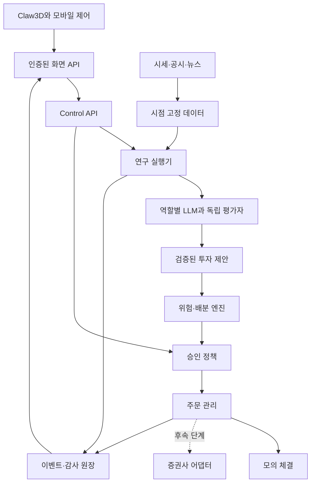

# Investment Town × Claw3D — 다중 LLM 투자 시스템 재설계

작성일: 2026-09-11 · 문서 버전: 1.0 · 상태: 구현 전 설계안

**목표는 여러 LLM의 투자 가설을 독립적으로 검증하고, 검증된 정책에 따라 하나의 포트폴리오를 운용하는 과정을 3D 투자 사무실에서 관찰·제어하는 것이다.** Claw3D는 화면과 상호작용, Investment Town은 데이터·연구·위험관리·주문 원장을 담당한다.

이 문서의 수치와 알고리즘은 검증을 시작하기 위한 설계값이다. 수익성 검증 결과나 실제 계좌 운용 권고가 아니다. 이번 변경 범위는 설계 문서이며, Claw3D 실행 연결·LLM 호출·실제 주문은 구현 완료로 간주하지 않는다.

함께 읽을 문서:

- [판단·매수·매도 알고리즘 상세](CLAW3D_ALGORITHMS.ko.md)
- [구현 순서·파일 변경·검증 명세](CLAW3D_DELIVERY_PLAN.ko.md)
- [기존 Control Center 스토리보드](STORYBOARD.md)
- [기존 토스증권 연동 계획](TOSS_LIVE_TRADING_PLAN.md)

## 1. 저장소를 확인하고 바뀐 판단

| 대상 | 확인한 기준 | 의미 |
|---|---|---|
| Investment Town | `main` / `d7d7c900b59b92c3d5ce4134333a8348ffb927a3` | 빈 저장소가 아니다. FastAPI, SQLite, 제어 API, 모의계좌, 선택적 TradingAgents 연결이 있다. |
| Claw3D | `main` / `0565b7892909eca7bbc8f2d9b0fad171dd75ad7c` | 패키지 버전 0.1.4. Next.js 16.1.7, React 19.2.3, Three.js·React Three Fiber 및 Phaser 의존성을 갖는다. |
| TradingAgents | 기존 프로젝트에 고정된 `a33fd4c0f134485a43553a2c23a63cb14adbd88f` | 연구 결과를 제안서로 변환하는 선택적 의존성이다. 주문 엔진과 분리되어 있다. |

근거: [Investment Town 기준 커밋](https://github.com/badbed7/investment-town/tree/d7d7c900b59b92c3d5ce4134333a8348ffb927a3), [Claw3D 패키지](https://github.com/iamlukethedev/Claw3D/blob/0565b7892909eca7bbc8f2d9b0fad171dd75ad7c/package.json), [기존 TradingAgents 어댑터](https://github.com/badbed7/investment-town/blob/d7d7c900b59b92c3d5ce4134333a8348ffb927a3/backend/src/investment_town/integrations/trading_agents.py).

### 진행 중인 기존 작업

작성일 현재 [초안 PR #6](https://github.com/badbed7/investment-town/pull/6), head `518b7c9d7014e23b6990cd5f9186658177bce91c`도 확인했다. 사람 승인, 연구 run·Blackboard·체크포인트·사용량 기록이 포함되어 있으나 main에는 아직 병합되지 않았다. 아래 현재 구현 표는 main 기준이다.

새 구현은 이 PR의 계약과 저장 구조를 재사용하는 방향으로 설계한다. 다만 해당 실행기는 upstream 분석을 한 번 완료한 뒤 저장된 결과를 단계별로 반영한다. 각 LLM의 실제 실행 시작/종료가 실시간으로 제공된다고 간주하지 않는다. 3D에서는 결과 반영 타임라인과 실제 작업 진행 타임라인을 구분해야 한다. [PR #6 런타임 문서](https://github.com/badbed7/investment-town/blob/518b7c9d7014e23b6990cd5f9186658177bce91c/docs/RESEARCH_RUNTIME.md)

### 현재 구현과 필요한 보강

| 항목 | 현재 코드에서 확인한 사실 | 새 설계 |
|---|---|---|
| 연구 실행 | 기본 `research.py`는 단계 목록 반환. 선택적 TradingAgents는 요청을 스레드로 실행한다. | 영속 작업 큐, 단계별 결과·취소·재시도·비용 제한을 가진 실행기 |
| 연구 제안 | Buy 등 등급을 buy/hold/sell로 매핑하고 보고서를 저장한다. | 근거, 공통 예측 질문, 모델별 판단, 비용·불확실성, 제안 버전을 저장 |
| 주문 | `/api/v1/paper/orders`는 존재한다. 연구 제안 승인과 연결된 주문 경로는 없다. | 검증한 제안→위험검사→승인 정책→주문 의도→체결 원장 |
| 모의 체결 | 입력 가격에 즉시 전량 체결한다. | 미래 호가/봉에 따른 체결, 비용, 부분 체결, 미체결, 취소 |
| 자산 평가 | `book_value = cash + cost_basis`이며 시장가격 평가액이 아니다. | 원가와 시가 NAV를 분리하고 미실현손익·환율·수수료 반영 |
| 중지 | 프로젝트 상태 전이와 이벤트를 기록한다. 실행 중 LLM 스레드와 실제 외부 주문의 취소를 보장하지 않는다. | 영속 취소 플래그, 단계별 체크, 주문 발송 차단, 주문 상태 대조 |
| 이벤트 | DB sequence가 있으나 실시간 전달은 메모리 큐이고 가득 차면 오래된 항목을 제거한다. | DB outbox, cursor 재전송, 누락 감지와 snapshot 복원 |
| 프런트엔드 | `apps/town-web`는 계획 README 수준이다. | 이 경로 아래 Claw3D를 독립 앱으로 추가 |

근거: [API 라우터](https://github.com/badbed7/investment-town/blob/d7d7c900b59b92c3d5ce4134333a8348ffb927a3/backend/src/investment_town/api/router.py), [모의계좌](https://github.com/badbed7/investment-town/blob/d7d7c900b59b92c3d5ce4134333a8348ffb927a3/backend/src/investment_town/broker/paper.py), [프로젝트 제어와 이벤트](https://github.com/badbed7/investment-town/blob/d7d7c900b59b92c3d5ce4134333a8348ffb927a3/backend/src/investment_town/control.py).

## 2. 제품 범위와 설계 결정

### 기본 실험 프로필

| 구분 | 첫 구현의 기본값 | 확장 조건 |
|---|---|---|
| 시장 | 미국 주식, USD 모의계좌, 허용 종목 10~20개 | 국내 주식은 별도 KRW 계좌·거래소·호가단위·비용 프로필로 추가 |
| 거래 방식 | 정규장, 현금, 정수 주식, 매수 후 보유/매도 | 레버리지·공매도·파생상품은 이 버전 범위 밖 |
| 판단 주기 | 거래일당 1회 정기 판단 + 중대한 신규 공시/뉴스 재검토 | 실시간 위험 모니터는 별도 코드로 지속 실행 |
| 예측 기간 | 공통 5거래일 | 20거래일 전략은 별도 모델 평가·별도 정책으로 실험 |
| 운영 단계 | Research → realistic Paper → Shadow → 승인 Live → 제한 자동화 | 각 단계 검증 완료 후 환경별로 승격 |
| 화면 | PC 3D 사무실 + 모바일 2D 제어 화면 | 3D를 닫아도 서버 연구·위험 감시는 지속 |
| 증권사 | 기존 토스 연동 계획을 유지 | 실제 사용 권한과 공식 계약을 확인한 뒤 계좌 연결 |

미국 시장과 5거래일은 현재 USD 모의계좌와 연결하기 위한 제안값이다. 사용자가 해당 시장·투자 기간을 확정했다는 뜻은 아니다. 총자산·생활비·개인 계좌정보를 저장소 설정 예시에 넣지 않는다.

### 핵심 결정

1. **기존 Python 백엔드를 중심으로 확장한다.** 모바일 Control Center와 프로젝트 레지스트리를 유지한다.
2. **Claw3D의 `custom` HTTP provider를 연결점으로 쓴다.** 투자 목적만을 위해 OpenClaw 전체 실행 환경을 필수로 도입하지 않는다.
3. **Claw3D 전체를 독립 하위 앱으로 들여온다.** 초기부터 3D 컴포넌트만 추출하면 화면 상태·세션·오피스 연동을 재구현해야 한다.
4. **역할과 모델을 분리한다.** 뉴스 분석가, 반론가 등은 역할이며, GPT·Claude·Gemini 계열 등 서로 다른 모델 구성이 역할을 수행한다. 정확한 모델 ID는 실험마다 고정한다.
5. **LLM은 판단 근거와 제안만 생성한다.** 현금·수량·한도·주문 상태는 서버가 계산한다.
6. **복수 LLM의 가치는 비교 실험으로 판단한다.** 세 모델이 동의했다는 사실만으로 정확성을 인정하지 않는다.
7. **의견 분열과 정보 부족을 정상 결과로 취급한다.** `WAIT`와 `ABSTAIN`도 저장·평가한다.

## 3. 전체 시스템 구조



단일 운용 계좌의 주문 작성자는 OMS(Order Management System) 하나다. 각 LLM에게 같은 실제 계좌를 따로 맡기지 않는다. 모델 비교가 필요하면 **가상 하위계좌를 모델별로 분리**하고 동일한 초기자금·데이터·체결 엔진을 적용한다.

### 실행 모드의 의미

| 모드 | 데이터 | 주문 처리 | 목적 |
|---|---|---|---|
| Research | 과거 또는 현재 | 주문 없음 | 근거 검증, 판단 기록 |
| Replay Paper | 시점 고정 과거 데이터 | 내부 체결 시뮬레이터 | 수식·회계·정책 회귀 검증 |
| Forward Paper | 현재 시세 | 내부 체결 시뮬레이터 | 미래를 모르는 상태의 평가 |
| Shadow | 현재 시세·선택적 실제 잔고 조회 | 주문 의도만 기록 | 계좌 제약과 실행 가능성 검증 |
| 승인 Live | 실제 | 사용자가 확인한 주문만 발송 | 제한된 실제 운영 검증 |
| 제한 자동화 | 실제 | 사전 승인된 정책·종목·한도 내 발송 | 검증된 정책의 운영 |

Live는 별도 배포·자격증명·DB 또는 명시적으로 격리된 스키마를 사용한다. 채팅 문장이나 브라우저 설정값 하나로 모드를 변경할 수 없게 한다.

## 4. 여러 LLM이 협업하는 방법론

### 역할별 책임

| 역할 | 입력과 결과 | 구현 방식/권한 |
|---|---|---|
| Director | 일정·데이터·비용을 확인하고 작업을 배정 | 상태 머신이 실행을 통제, LLM은 설명 보조 |
| News Analyst | 공시·뉴스의 사실, 관련 종목, 방향, 유효기간 | 읽기 전용 LLM, 출처 ID 필수 |
| Fundamental Analyst | 재무 변화, 현금흐름, 밸류에이션 가설 | 지표 계산은 Python, 해석은 LLM |
| Quant Analyst | 추세·변동성·유동성·시장 노출 | 결정적 계산 + 선택적 해설 |
| Macro Analyst | 금리·환율·시장 국면 | 발표시각이 보존된 데이터 해석 |
| Bull Researcher | 매수 가설의 가장 강한 근거 | 낙관적 가설과 반증 조건 작성 |
| Bear Researcher | 가설이 틀리는 경로와 누락 정보 | 비관적 가설과 반증 조건 작성 |
| Judge A/B/C | 동일한 최종 자료를 보고 공통 예측 질문에 독립 응답 | 서로 다른 모델 계열 우선, 상대 투표 비공개 |
| Risk Analyst | 정성 위험과 추가 확인이 필요한 항목 | 위험 플래그 제안, 허용 권한 없음 |
| Risk Gate / Portfolio Engine | 자산 배분·수량·한도 통과 여부 | 결정적 코드, LLM이 한도를 해제할 수 없음 |
| CIO | 결정, 소수 의견, 거절 사유를 사람이 읽게 요약 | 원장의 결정 결과만 설명 |
| Broker / Accountant | 주문·부분체결·잔고·손익 | 결정적 코드, 아바타는 처리 상태만 표시 |

모든 역할을 매번 비싼 모델로 실행할 필요는 없다. 정기 스캔은 계산과 캐시로 처리하고, 의미 있는 후보만 전문 분석·토론에 올린다. Bull/Bear를 독립 평가자 투표에 추가해 표 수를 늘리지 않는다.

### 한 종목의 의사결정 절차

1. 분석 마감시각을 고정하고 동일한 `snapshot_id`를 만든다.
2. 뉴스·재무·퀀트·거시 분석을 독립적으로 수행한다. 첫 보고서 제출 전에는 다른 분석가의 결론을 보지 않는다.
3. 수치와 인용 근거를 검사하고, 모순되는 공시는 사실 검증 단계로 보낸다.
4. Bull/Bear가 동일한 보고서 묶음을 받아 가설·반론·반증 조건을 작성한다. 기본 1회씩, 추가 반론 최대 1회씩이다.
5. 검증된 새 정보만 공통 자료에 추가하고 자료 버전을 잠근다. 토론 문장은 새로운 사실로 승격하지 않는다.
6. Judge A/B/C가 같은 질문·기간·자료를 받아 서로의 답을 보지 않고 평가한다.
7. 서버가 보정된 예측·거래비용·의견 차이·계좌 제약을 결합한다.
8. 포트폴리오 엔진이 `BUY / HOLD / REDUCE / EXIT / WAIT`와 수량을 만든다.
9. 위험·승인 절차를 통과한 주문 의도만 OMS로 간다.
10. 일정 기간 후 모든 판단의 결과를 기록하고 모델과 정책을 평가한다.

이 구조는 TradingAgents의 전문 역할과 Bull/Bear 토론을 참고하되, 공통 라벨·독립 평가·수량·체결·평가 원장을 Investment Town이 소유하도록 확장한 설계다. 논문의 성과를 이 프로젝트의 기대수익으로 사용하지 않는다. [TradingAgents 논문](https://arxiv.org/abs/2412.20138)

## 5. Claw3D 연결: 이미 있는 기능과 추가할 기능

Claw3D는 외부 오케스트레이터를 붙일 수 있는 `custom` 경계를 제공한다. 현재 소스는 가이드의 미래 제안보다 제한적이므로 아래 실제 동작을 기준으로 구현한다. [custom provider 가이드](https://github.com/iamlukethedev/Claw3D/blob/0565b7892909eca7bbc8f2d9b0fad171dd75ad7c/docs/integrations/custom-provider-reference.md), [실제 provider 코드](https://github.com/iamlukethedev/Claw3D/blob/0565b7892909eca7bbc8f2d9b0fad171dd75ad7c/src/lib/runtime/custom/provider.ts)

| 연결 항목 | 기준 커밋에서의 동작 | Investment Town 작업 |
|---|---|---|
| 런타임 탐색 | `/health`, `/state`, `/registry` 조회 | 기존 `/api/v1` API와 별도 호환 facade 추가 |
| 에이전트 목록 | `/state.active`의 역할→문자열/문자열 배열에서 합성 | 해당 자료형을 정확히 반환 |
| 모델 목록 | `/registry.models` 객체의 키를 사용 | 서버 모델 alias 목록 반환 |
| 채팅 | `/v1/chat/completions`, `stream: false` | 비스트리밍 응답부터 연결, 투자 주문과 분리 |
| 세션 | provider 인스턴스의 메모리 Map | 서버 세션·메시지 저장 및 재접속 복원 추가 |
| 실시간 이벤트 | `onRuntimeEvent`는 현재 빈 구독 처리 | Investment Town event stream→화면 상태 브리지 구현 |
| 승인 | custom capability에 approvals가 없고 조회는 빈 기본값 | 전용 투자 승인 패널과 서버 API 추가 |
| 중지 | 클라이언트 요청 Abort | 서버 작업 취소·OMS 정지와 별도 연결 |
| 인증 전달 | custom proxy는 Accept/Content-Type만 명시적으로 전달 | 서버 보관 인증정보를 BFF에서 주입 |

`RuntimeEvent`의 현재 타입은 summary-refresh, chat.*, run.lifecycle, unknown이다. 가이드에 나오는 presence.changed/tool.progress를 이미 구현된 타입으로 가정하지 않는다. 처음에는 별도의 `InvestmentEvent` reducer가 사무실 상태를 갱신하며, 공용 타입 변경은 이후 별도 PR로 제한한다. [런타임 타입](https://github.com/iamlukethedev/Claw3D/blob/0565b7892909eca7bbc8f2d9b0fad171dd75ad7c/src/lib/runtime/types.ts)

### 호환 facade 응답 예시

아래는 **새로 구현할 계약**이다. 기존 서버의 실제 응답이라고 제시하지 않는다. `model-a` 등은 외부 모델 제품명이 아닌 서버 등록 alias다.

`GET /state`

```json
{
  "profileName": "investment-town-paper",
  "runtime": {"name": "Investment Town", "version": "next", "status": "ready"},
  "active": {
    "news": "model-a",
    "fundamental": "model-b",
    "bear": "model-c",
    "judge-a": "model-a",
    "judge-b": "model-b",
    "judge-c": "model-c"
  },
  "identity": {"name": "Investment Town", "role": "director", "model_id": "model-a"}
}
```

`active`는 역할 카탈로그 호환용이다. 실제 실행 중 여부는 이벤트/snapshot의 `agent_status`로 구분한다. idle 역할을 바쁘게 애니메이션하지 않는다.

`GET /registry`

```json
{
  "models": {
    "model-a": {"label": "Analyst A"},
    "model-b": {"label": "Analyst B"},
    "model-c": {"label": "Analyst C"}
  }
}
```

`POST /v1/chat/completions`는 `role`, `lane`, `conversation_id`, `session_id`, `messages`, `model`, `stream`을 받을 수 있다. 서버는 등록된 역할과 세션 권한을 확인하고, 투자 정책의 모델 선택은 서버 설정을 적용한다. 클라이언트가 보낸 `model`이나 역할 문자열로 권한을 높이지 않는다.

```json
{
  "id": "chat_example_001",
  "object": "chat.completion",
  "choices": [{"index": 0, "message": {"role": "assistant", "content": "최신 연구 실행은 완료되었고, 가격 유효시간을 초과해 신규 매수는 보류되었습니다."}, "finish_reason": "stop"}]
}
```

채팅에는 질문 응답만 맡긴다. 연구 시작은 작업 API, 승인과 주문은 명시적 버튼/API 계약을 사용한다. “전부 사 줘”라는 채팅도 주문으로 직접 해석하지 않는다.

### 인증과 프록시 보강

현재 proxy의 호스트 allowlist만으로 투자 권한 경계가 완성되지는 않는다. [custom route 소스](https://github.com/iamlukethedev/Claw3D/blob/0565b7892909eca7bbc8f2d9b0fad171dd75ad7c/src/app/api/runtime/custom/route.ts)

- 배포에서는 서버에 고정한 upstream ID만 허용하고 사용자 입력 URL을 그대로 외부 요청에 쓰지 않는다.
- scheme·host·port·경로·HTTP method를 함께 제한하고 redirect를 차단한다.
- 런타임 facade와 주문 API의 route allowlist를 분리한다.
- 브라우저는 짧은 세션 쿠키, BFF는 제한된 service identity, OMS만 증권사 비밀값을 갖는다.
- CSRF/Origin 검사와 서버 권한 검사를 적용한다. 기존 단일 bearer token을 모바일·LLM에 공유하지 않는다.
- 인증정보를 query string·로그·3D 말풍선에 넣지 않는다.
- Claw3D의 쉘·스킬 설치·GitHub 등 기능은 투자 역할의 허용 도구 목록에 포함하지 않는다.

## 6. 3D 투자 사무실의 UX

| 공간 | 화면에서 보이는 내용 | 누르면 열리는 정보 |
|---|---|---|
| 뉴스 데스크 | 확인한 신규 공시/뉴스 수, 최신 시각 | 원문 링크, 중복 기사, 사실/해석 구분 |
| 기업 분석실 | 재무 변화와 분석 완료 상태 | 계산식, 사용한 보고서, 자료 시각 |
| 퀀트 연구실 | 후보 필터, 변동성, 유동성 | 지표 값과 단위, 계산 버전 |
| 회의실 | Bull/Bear 가설과 소수 의견 | 근거·반증 조건·해결되지 않은 쟁점 |
| 심사석 | A/B/C 판단과 의견 차이 | 모델 버전, 보정 여부, 판단 이력 |
| 위험관리실 | 노출·일일 손실·주문 제한 | 실패한 규칙과 통과 조건 |
| CIO 책상 | 확정된 제안 또는 보류 | 주문 수량 계산과 승인 화면 |
| 거래 데스크 | 접수/부분체결/취소/확인 중 | 실제 체결 원장과 주문 타임라인 |

색상만으로 상태를 표현하지 않고 상태 텍스트와 아이콘을 함께 표시한다. 핵심 상태는 `IDLE`, `RUNNING`, `WAITING_DATA`, `WAITING_APPROVAL`, `FAILED`, `CANCELLED`, `DONE`이다. “연결됨”과 “자료가 최신임”은 별도 상태다.

상단에는 운영 모드, 데이터 시각, 계좌 식별 별칭, NAV, 일일 손익, 신규 주문 차단 여부를 항상 표시한다. 모의 수익과 실제 수익을 같은 숫자로 합치지 않는다. 모바일에서는 3D 로딩 없이 동일한 승인·중지·원장을 열 수 있게 한다.

모델 사고 과정 전문을 노출하려 하지 않는다. 사용자가 검증할 수 있는 **판단 요약·계산 결과·출처·반론·결정 사유**를 보여준다. 아바타 이동 완료나 회의 애니메이션 타이머가 주문을 발생시키면 안 된다.

## 7. 데이터·이벤트·원장의 기준

### 데이터 시점

모든 자료는 `source_time`, `published_at`, `available_at`, `ingested_at`, `version`, `content_hash`를 구분한다. 과거 재현에서는 분석 시점 이전에 실제로 이용 가능했던 버전만 사용한다. 최신 재작성 재무제표를 과거 자료처럼 넣지 않는다.

미국 공시는 SEC의 제출 이력과 XBRL API를 수집 경로로 사용할 수 있다. 원문 공시와 태그·단위·기간·접수번호를 함께 보관한다. API의 최신 집계값 자체가 시점 고정 데이터베이스를 대신하지는 않는다. [SEC EDGAR API](https://www.sec.gov/search-filings/edgar-application-programming-interfaces)

호가·거래정지·장 캘린더·환율·기업행동은 LLM이 추정하지 않는다. 데이터 계약에 허용 지연과 재배포/보관 조건을 기록한다. 뉴스 본문과 유료 시세를 공개 GitHub에 저장하지 않는다.

### 이벤트 구조

```json
{
  "schema_version": 1,
  "event_id": "evt_example_001",
  "sequence": 1281,
  "project_id": "investment-town",
  "run_id": "run_example_001",
  "agent_id": "risk-gate",
  "type": "risk.rejected",
  "occurred_at": "2026-09-11T14:00:00Z",
  "recorded_at": "2026-09-11T14:00:00.020Z",
  "payload": {"proposal_id": "proposal_example_001", "reason_codes": ["STALE_QUOTE"]}
}
```

snapshot은 `as_of_sequence`를 포함한다. 클라이언트는 그 이후 이벤트를 요청하고 event_id로 중복을 제거한다. DB sequence의 빈 번호 자체를 손실로 판정하지 않는다. 프로젝트 필터·롤백 등으로 번호가 비연속일 수 있으므로 서버 cursor와 보존 범위를 사용한다. cursor가 만료되거나 큐 overflow가 발생하면 `RESYNC_REQUIRED`를 보내고 snapshot을 다시 받는다.

핵심 변경과 outbox 이벤트는 같은 DB 트랜잭션에 기록한다. WebSocket/SSE는 전달 수단이며 원장이 아니다. 서버가 다시 시작되면 checkpoint와 outbox에서 복구한다.

### 영속성

첫 수직 구현은 SQLite + 단일 worker로 유지할 수 있다. 복수 실행기·상시 계좌 연결 전 PostgreSQL로 옮긴다. 계좌 잠금, 주문 unique key, 낙관적 버전 확인, worker lease/fencing을 도입한다. Redis는 작업 전달·캐시에 사용 가능하지만 잔고와 주문의 최종 원장은 관계형 DB에 둔다.

## 8. 토스증권 연결 계획 갱신

2026-09-11 확인한 공식 OpenAPI는 **1.2.15**이며 REST 외에 시세·호가·본인 주문 이벤트 WebSocket과 별도의 AsyncAPI 문서를 안내한다. 기존 문서의 “REST 전용, WebSocket 추후 지원” 가정은 갱신한다. 이번 확인에서는 AsyncAPI 본문을 읽지 못했으므로 채널명·재접속 규칙·메시지 스키마는 확정하지 않는다. [공식 REST 스펙](https://openapi.tossinvest.com/openapi-docs/latest/openapi.json)

연결 방식은 REST로 계좌·주문·잔고를 대조하고, 검증된 WebSocket으로 빠른 변경 알림을 받는 구조다. 소켓 메시지를 놓쳤을 때에도 REST 대조가 가능해야 한다. API 제공 여부와 사용자의 실제 신청·허용 IP·계좌 권한 확보는 별개다.

계좌 연결 전에도 내부 paper 구현을 개발할 수 있다. 다른 증권사를 추가하더라도 `BrokerAdapter`의 주문·조회·취소·체결 대조 계약을 유지한다. Alpaca paper를 비교 대상으로 쓸 경우에도 시장 충격·지연 슬리피지·배당 등의 모의환경 차이를 반영해야 한다. [Alpaca paper 제약](https://docs.alpaca.markets/us/docs/paper-trading)

## 9. 유지보수와 의존성 전략

Claw3D를 `apps/town-web/claw3d/`에 git subtree로 추가하는 방식을 제안한다. 기존 `apps/town-web/README.md`가 있어도 하위 prefix는 충돌하지 않는다. 소스 기준 SHA를 고정하고 변경은 custom provider·투자 화면·BFF 주변으로 제한한다.

Claw3D의 MIT 라이선스와 저작권 고지를 유지한다. 별도 3D 에셋과 의존성의 라이선스도 가져오는 범위에 맞춰 확인한다. 기존 TradingAgents의 Apache-2.0 고정 의존성 정책은 별도 유지한다. [Claw3D LICENSE](https://github.com/iamlukethedev/Claw3D/blob/0565b7892909eca7bbc8f2d9b0fad171dd75ad7c/LICENSE)

upstream 갱신은 자동 배포하지 않는다. 새 SHA의 API·타입·보안·화면 차이를 확인하는 PR과 계약 검증을 거쳐 갱신한다. 투자 판단에 영향을 주는 모델·프롬프트·도구·전략 변경 역시 새 정책 버전으로 기록한다.

## 10. 이 설계가 성공했다고 판단할 기준

- 동일 데이터·정책·확정 LLM 출력으로 같은 수량과 주문 의도를 재현한다.
- 어떤 매수·매도도 자료→독립 판단→계산→위험검사→승인→체결까지 추적할 수 있다.
- 세 모델의 다수 의견도 오래된 시세, 현금 부족, 손실 제한을 통과하지 못한다.
- 가격을 모르면 NAV를 임의로 채우지 않고 평가 불완전 상태를 표시한다.
- 재접속·프로세스 장애·이벤트 중복이 중복 주문으로 이어지지 않는다.
- 여러 LLM을 쓰는 전략이 단순 기준전략보다 비용 대비 도움이 되는지 측정할 수 있다.
- 3D 화면의 문제가 연구 실행·위험 차단·원장을 바꾸지 않는다.

구체적인 수식, 매도 우선순위, 주문 상태 전이, 운영 한도는 [알고리즘 명세](CLAW3D_ALGORITHMS.ko.md)에 정의한다. 구현 범위와 완료 조건은 [개발 계획](CLAW3D_DELIVERY_PLAN.ko.md)을 따른다.
